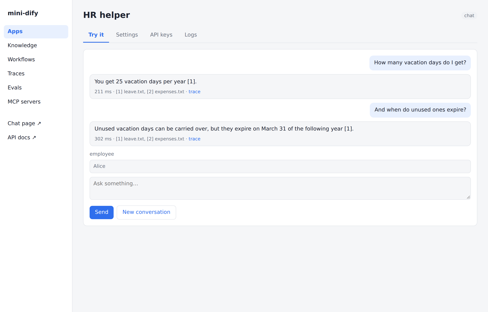
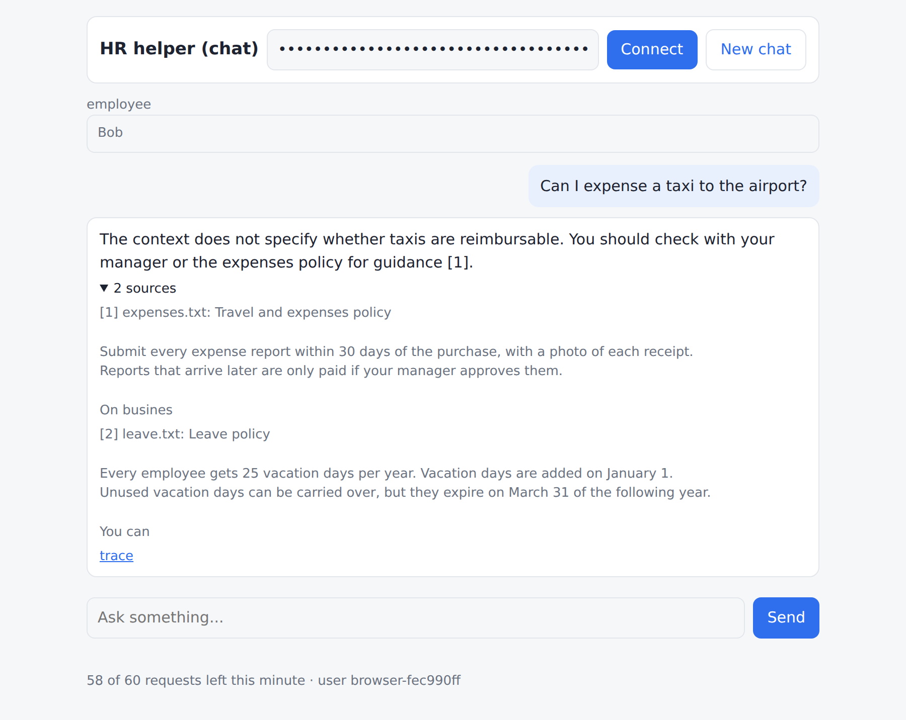
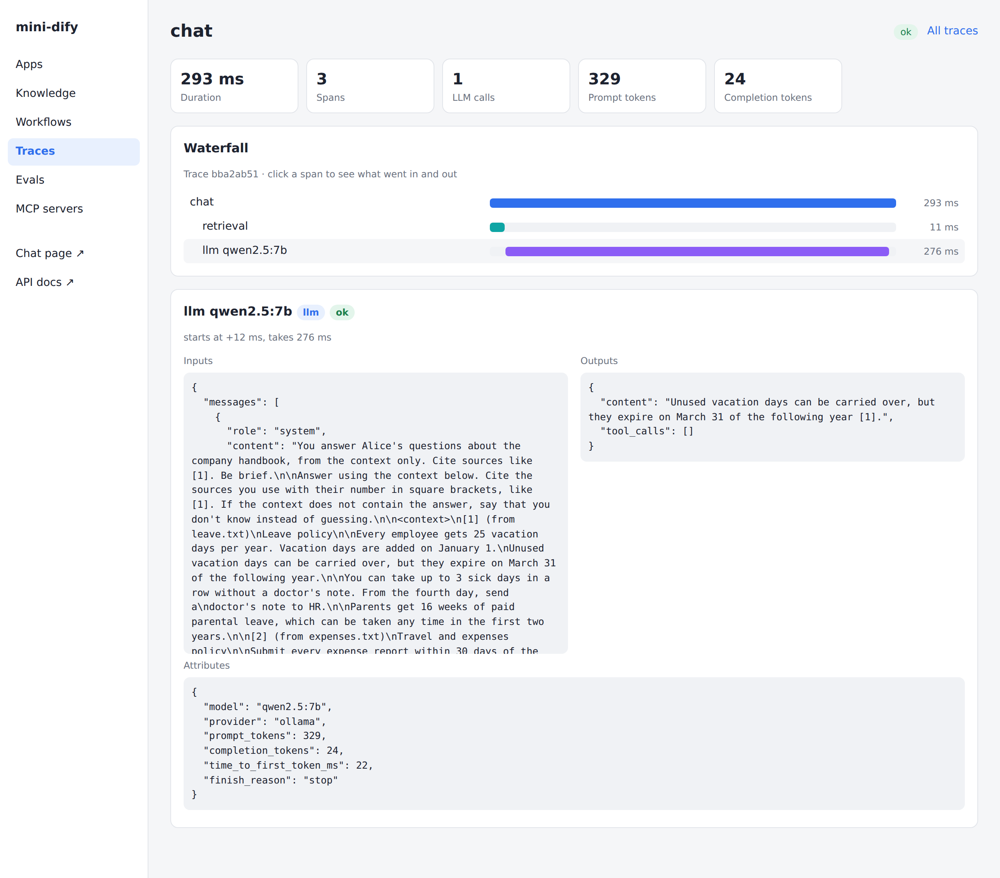
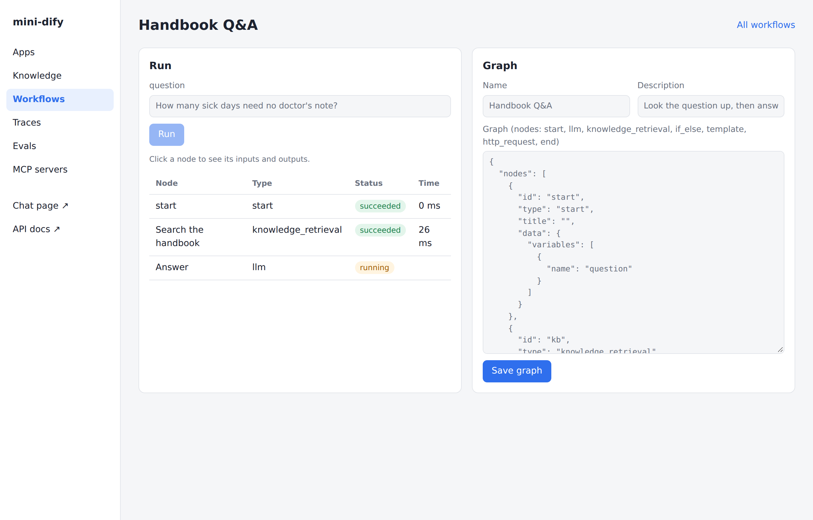
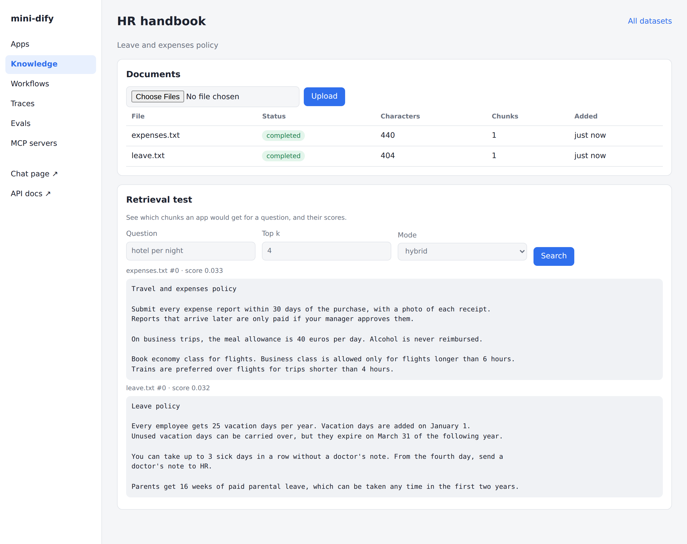
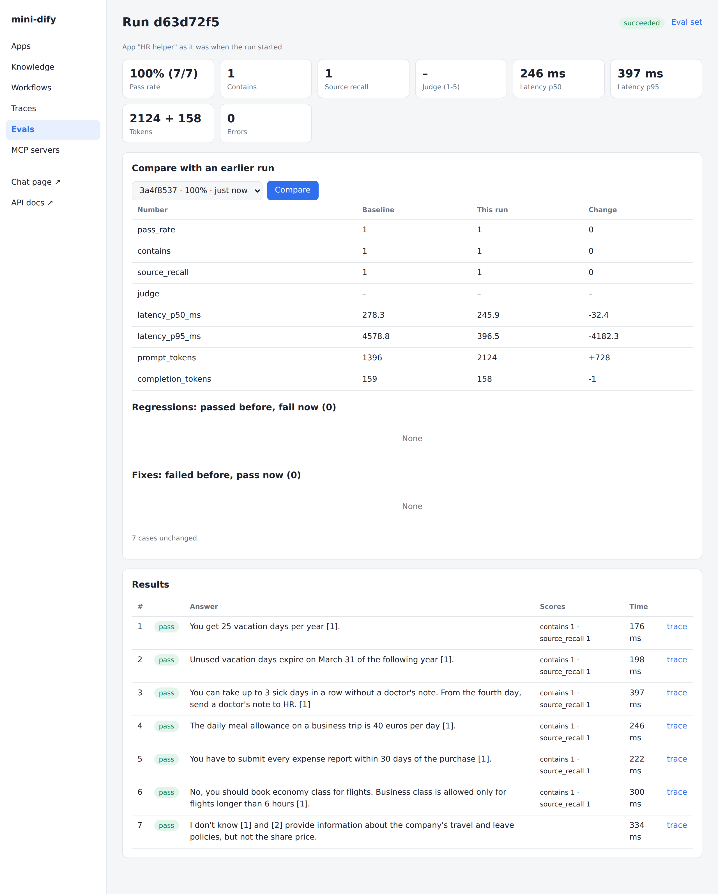

# mini-dify

A small, from-scratch rebuild of an LLM app platform in the style of [Dify](https://github.com/langgenius/dify), built phase by phase to learn how these platforms work: model providers, chat apps, RAG, agents and tool calling, a workflow engine, MCP, and observability.

This is a learning project, not a production fork. Each phase is a separate PR, and each one is tied to the part of Dify's codebase it mirrors.



## Stack

- **API:** Python 3.12, FastAPI, uvicorn
- **Data:** Postgres 16 + pgvector (relational data and embeddings in one database), SQLAlchemy (async)
- **Queue / cache:** Redis
- **LLM:** Ollama (local models on the GPU) behind a provider interface
- **Tooling:** uv, ruff, pytest, Docker Compose, GitHub Actions

## Running locally

Requirements: Docker, [uv](https://docs.astral.sh/uv/), [Ollama](https://ollama.com) with a chat model and an embedding model pulled (`ollama pull llama3.2:3b` and `ollama pull nomic-embed-text`).

```bash
cp .env.example .env
docker compose up -d                                   # Postgres + pgvector, Redis
uv sync                                                # install dependencies
uv run alembic upgrade head                            # create / update the database tables
uv run uvicorn mini_dify.main:app --reload --app-dir src
```

Then:

- http://localhost:8000/: the console (see [Console](#console))
- http://localhost:8000/health: liveness check
- http://localhost:8000/ready: readiness check (Postgres, pgvector, Redis)
- http://localhost:8000/docs: interactive API docs

## Try it

Whole reply at once:

```bash
curl -s localhost:8000/v1/chat -H 'content-type: application/json' \
  -d '{"messages":[{"role":"user","content":"What is Python?"}]}'
```

Streamed token by token (Server-Sent Events):

```bash
curl -N localhost:8000/v1/chat -H 'content-type: application/json' \
  -d '{"messages":[{"role":"user","content":"Write a haiku about GPUs"}],"stream":true}'
```

Optional fields: `model` (any model you've pulled in Ollama), `temperature` (0 to 2), `max_tokens`.

## Chat apps

An app saves a system prompt (with `{{variables}}`), a model, a temperature and a memory window. Conversations with it are stored in Postgres, and the last N messages are sent back to the model as memory.

```bash
# Create an app
curl -s localhost:8000/v1/apps -H 'content-type: application/json' -d '{
  "name": "Python tutor",
  "system_prompt": "You are a patient Python tutor for {{name}}, a {{level}} programmer.",
  "memory_window": 6
}'

# Start a conversation (inputs fill the variables)
curl -s localhost:8000/v1/apps/<app_id>/chat-messages -H 'content-type: application/json' \
  -d '{"query": "What is a list?", "inputs": {"name": "Abhi", "level": "beginner"}}'

# Continue it (add "stream": true to stream)
curl -s localhost:8000/v1/apps/<app_id>/chat-messages -H 'content-type: application/json' \
  -d '{"query": "And a tuple?", "conversation_id": "<conversation_id>"}'

# Read the history
curl -s localhost:8000/v1/conversations/<conversation_id>/messages
```

## Knowledge bases (RAG)

A dataset holds documents (`.txt`, `.md`, `.pdf`). Each upload is split into overlapping chunks, embedded with `nomic-embed-text`, and stored in Postgres with pgvector. Retrieval can be `vector` (meaning), `keyword` (full-text search) or `hybrid` (both, merged with Reciprocal Rank Fusion). An app linked to datasets answers from them and returns numbered citations.

```bash
# Create a dataset
curl -s localhost:8000/v1/datasets -H 'content-type: application/json' \
  -d '{"name": "Handbook", "chunk_size": 500, "chunk_overlap": 80}'

# Upload a document (indexing runs in the background)
curl -s localhost:8000/v1/datasets/<dataset_id>/documents -F file=@handbook.pdf

# Check its status, then look at the chunks
curl -s localhost:8000/v1/datasets/<dataset_id>/documents
curl -s localhost:8000/v1/documents/<document_id>/chunks

# Search the dataset directly
curl -s localhost:8000/v1/datasets/<dataset_id>/retrieve -H 'content-type: application/json' \
  -d '{"query": "How many vacation days do I get?", "top_k": 4, "mode": "hybrid"}'

# Link it to an app: answers now include "citations"
curl -s localhost:8000/v1/apps -H 'content-type: application/json' \
  -d '{"name": "HR bot", "system_prompt": "You answer HR questions.", "dataset_ids": ["<dataset_id>"]}'
```

## Agents and tools

Give an app a list of `tools` and it becomes an agent: instead of answering straight away, the model can call tools, read the results and decide what to do next, until it can answer. If the app also has datasets, a `knowledge_search` tool is added automatically.

```bash
# See the available tools
curl -s localhost:8000/v1/tools

# Create an agent app (agent_mode: "function_calling" or "react")
curl -s localhost:8000/v1/apps -H 'content-type: application/json' -d '{
  "name": "Helper",
  "system_prompt": "You are a helpful assistant. Use tools when they help.",
  "tools": ["calculator", "current_time", "wikipedia"],
  "agent_mode": "function_calling",
  "max_iterations": 5
}'

# Chat with it: the response includes "agent_steps" (each tool call and its result)
curl -s localhost:8000/v1/apps/<app_id>/chat-messages -H 'content-type: application/json' \
  -d '{"query": "What is 1234 * 5678, and what day is it in Sydney?"}'
```

With `"stream": true`, each tool call arrives as an `agent_step` event as it happens, then the answer.

Function calling needs a model with tool support in Ollama (`qwen2.5:7b` and `llama3.2:3b` both have it). ReAct works with any model, because the tools are described in the prompt and the reply is parsed as text.

## Workflows

A workflow is a graph of nodes joined by edges, stored as JSON. Nodes read earlier nodes' outputs with references like `{{#start.question#}}` or `{{#llm.text#}}` (the same syntax as Dify). Node types: `start`, `llm`, `knowledge_retrieval`, `if_else`, `template`, `http_request` and `end`. Nodes that don't depend on each other run at the same time, an `if_else` node follows its `true` or `false` edge and skips the other branch, and every run is saved with each node's inputs, outputs and timing.

```bash
# Create a workflow: look a question up in a dataset, then answer from it
curl -s localhost:8000/v1/workflows -H 'content-type: application/json' -d '{
  "name": "Handbook Q&A",
  "graph": {
    "nodes": [
      {"id": "start", "type": "start", "data": {"variables": [{"name": "question"}]}},
      {"id": "kb", "type": "knowledge_retrieval",
       "data": {"dataset_ids": ["<dataset_id>"], "query": "{{#start.question#}}"}},
      {"id": "llm", "type": "llm",
       "data": {"prompt": "Answer from this context:\n{{#kb.text#}}\n\nQuestion: {{#start.question#}}"}},
      {"id": "end", "type": "end",
       "data": {"outputs": [{"name": "answer", "value": "{{#llm.text#}}"}]}}
    ],
    "edges": [
      {"source": "start", "target": "kb"},
      {"source": "kb", "target": "llm"},
      {"source": "llm", "target": "end"}
    ]
  }
}'

# Run it (add "stream": true to get one event per node as it happens)
curl -s localhost:8000/v1/workflows/<workflow_id>/run -H 'content-type: application/json' \
  -d '{"inputs": {"question": "How many vacation days do I get?"}}'

# Read a past run, with every node's inputs, outputs and timing
curl -s localhost:8000/v1/workflow-runs/<run_id>
```

HTTP request nodes can't call private addresses (localhost, 10.x, 192.168.x, cloud metadata) unless `WORKFLOW_HTTP_ALLOW_PRIVATE=true` is set.

## MCP

[MCP](https://modelcontextprotocol.io) (Model Context Protocol) is a standard way for AI apps to share tools. mini-dify speaks it in both directions, over Streamable HTTP (protocol versions 2024-11-05 to 2025-11-25).

**As a server:** `POST /mcp` offers every workflow as a tool. The tool's name comes from the workflow's name, and its arguments are the start node's inputs. Any MCP client can call it, for example Claude Code:

```bash
claude mcp add --transport http mini-dify http://localhost:8000/mcp
```

**As a client:** register an MCP server by URL, and give its id to an app in `mcp_server_ids`. The app's agent can then call the server's tools, named `<server name>__<tool name>`.

```bash
# Register a server: mini-dify connects, lists its tools and saves them
curl -s localhost:8000/v1/mcp-servers -H 'content-type: application/json' \
  -d '{"name": "deepwiki", "url": "https://mcp.deepwiki.com/mcp"}'

# An agent app that can use them
curl -s localhost:8000/v1/apps -H 'content-type: application/json' -d '{
  "name": "Repo explainer",
  "system_prompt": "You answer questions about GitHub repositories. Use tools.",
  "model": "qwen2.5:7b",
  "mcp_server_ids": ["<mcp_server_id>"]
}'

# Re-list a server's tools after it changes
curl -s -X POST localhost:8000/v1/mcp-servers/<mcp_server_id>/refresh
```

Header values (for example an `Authorization` token) are sent to the server but never returned by the API. Like the workflow HTTP node, the client refuses private addresses unless `MCP_ALLOW_PRIVATE_URLS=true` is set, which you need for an MCP server running on your own machine.

## Tracing

Every chat message, agent answer and workflow run is recorded as a **trace**: a tree of **spans**, one for each step, with its inputs, outputs, timing and any error. LLM calls also record the model, tokens and time to first token. Responses include a `trace_id`.

```bash
# The newest traces, with span counts and token totals (add ?status=error for failures)
curl -s localhost:8000/v1/traces

# One trace as a tree, with every input and output
curl -s localhost:8000/v1/traces/<trace_id>

# The same trace drawn as text
curl -s localhost:8000/v1/traces/<trace_id>/text
```

```text
[chain] chat  +0ms  412ms  ok
├─ [retriever] retrieval  +2ms  35ms  ok  (3 chunks)
└─ [llm] llm qwen2.5:7b  +40ms  370ms  ok  (412+58 tokens, first token 95ms)
```

Spans are kept in memory while the request runs and saved in one go at the end, even when it fails. Set `TRACING_ENABLED=false` to turn tracing off.

## Evals

An **eval set** is a list of test questions, each with what a good answer looks like. Running it against an app answers every question through the app's normal API, scores the answers, and sums them up. Run it again after changing the prompt, the model or the knowledge, and compare: you see which questions got better or worse.

Each case can have:
- `must_include`: phrases the answer must contain (scored as the share found)
- `expected_sources`: files that should be among the answer's citations (`source_recall`)
- `expected_answer`: a reference answer, for an LLM **judge** to grade from 1 to 5 (when the run has `"judge": true`)

A case passes when every metric it has is perfect (the judge needs 4 or more). Latency and tokens are recorded too, and every answer keeps its `trace_id`.

```bash
# An eval set from a file (see examples/hr/)
curl -s localhost:8000/v1/eval-sets -H 'content-type: application/json' -d @examples/hr/eval-set.json

# Run it against an app (it runs in the background: poll until "status" isn't "running")
curl -s localhost:8000/v1/eval-sets/<eval_set_id>/runs -H 'content-type: application/json' \
  -d '{"app_id": "<app_id>", "judge": true, "judge_model": "qwen2.5:14b"}'
curl -s localhost:8000/v1/eval-runs/<run_id>

# What changed since an earlier run of the same set: regressions and fixes
curl -s "localhost:8000/v1/eval-runs/<run_id>/compare?baseline=<earlier_run_id>"
```

## Public API and chat page

Each app can have **API keys**, so other programs (a website, a script, a Slack bot) can use it without the console. A key works for one app only, and the full key is shown once, when it's created: only its SHA-256 hash is stored.

```bash
# Create a key (save "key" from the reply: it's never shown again)
curl -s localhost:8000/v1/apps/<app_id>/api-keys -H 'content-type: application/json' \
  -d '{"name": "website", "rate_limit_per_minute": 30}'

# List an app's keys (without the keys themselves), and revoke one
curl -s localhost:8000/v1/apps/<app_id>/api-keys
curl -s -X DELETE localhost:8000/v1/api-keys/<api_key_id>
```

The public API lives under `/public/v1` and takes the key as a Bearer token. `user` is your own id for the person asking: conversations belong to it, and other users can't read or continue them.

```bash
KEY=mdk-...
curl -s localhost:8000/public/v1/info -H "Authorization: Bearer $KEY"
curl -s localhost:8000/public/v1/chat-messages -H "Authorization: Bearer $KEY" \
  -H 'content-type: application/json' -d '{"query": "Hello!", "user": "alice"}'
curl -s "localhost:8000/public/v1/conversations?user=alice" -H "Authorization: Bearer $KEY"
curl -s "localhost:8000/public/v1/conversations/<conversation_id>/messages?user=alice" \
  -H "Authorization: Bearer $KEY"
```

Every key is limited to `RATE_LIMIT_PER_MINUTE` requests per minute (60 by default) unless it sets its own, counted in Redis over a sliding 60 second window. Responses carry `X-RateLimit-Limit` and `X-RateLimit-Remaining`. Over the limit you get `429` with `Retry-After`.

**Chat page:** open http://localhost:8000/ui/, paste a key and chat. It streams answers, shows tool calls and sources, and links each answer's trace. It's one HTML file, `src/mini_dify/static/index.html`, with no build step.



## Console

http://localhost:8000/ opens the console, a web page for everything above: no curl needed. It's plain JavaScript modules in `src/mini_dify/static/console/`, with no build step, and it only uses the same `/v1` API you can call yourself.

| Page | What you can do |
|---|---|
| Apps | Create and edit apps (prompt, model, knowledge, tools, MCP servers), chat with them, make API keys, read every conversation (from the console, the public API or evals) |
| Knowledge | Create datasets, upload documents, watch them index, read their chunks, test retrieval |
| Workflows | Edit a workflow's graph as JSON, run it and watch each node finish |
| Traces | Every answer and run as a waterfall of spans, with each span's inputs and outputs |
| Evals | Create eval sets, run them against an app, compare a run with an earlier one |
| MCP servers | Connect remote MCP servers and see their tools |

Three API endpoints were added for it: `PUT /v1/apps/{id}` (edit), `DELETE /v1/apps/{id}` (deletes its conversations, keys and eval runs too) and `GET /v1/apps/{id}/conversations` (the logs).

| | |
|---|---|
|  |  |
|  |  |

**Console token.** By default the console and its API (`/v1/...` and `/mcp`) have no login, which is fine on your own machine. Before anyone else can reach mini-dify, set `CONSOLE_TOKEN` in `.env`: every console API call then needs `Authorization: Bearer <token>`, and the console asks for the token once and keeps it in the browser. The public API keeps using API keys, and `/health` stays open.

**Screenshots.** `scripts/screenshots.py` fills mini-dify with the examples in `examples/hr/`, drives the console and the chat page in a headless browser with your real models, and saves the images above to `docs/images/`:

```bash
uv run --with playwright playwright install chromium   # once
uv run --with playwright python scripts/screenshots.py qwen2.5:7b
```

## Database migrations

Tables are managed with [Alembic](https://alembic.sqlalchemy.org). After changing `src/mini_dify/models.py`:

```bash
uv run alembic revision --autogenerate -m "describe the change"   # then read the generated file
uv run alembic upgrade head
```

## Tests and lint

```bash
uv run ruff check .
uv run ruff format --check .
uv run pytest -v
```

Tests use a separate `minidify_test` database (created by `docker/init.sql` on a fresh volume, or once by hand with `docker compose exec db createdb -U minidify minidify_test`).

CI runs the same checks on every pull request, against real Postgres and Redis service containers. Tests never call a real LLM: they use a fake provider and a mocked HTTP transport, so CI needs no GPU.

## Roadmap

| Phase | What | Status |
|---|---|---|
| 0 | Project skeleton, local stack, CI | ✅ |
| 1 | Model provider layer, streaming, token and latency tracking | ✅ |
| 2 | Chat apps, prompt templates, conversation memory | ✅ |
| 3 | RAG: ingestion, chunking, embeddings, hybrid retrieval, citations | ✅ |
| 4 | Tools and agents (function calling, ReAct) | ✅ |
| 5 | Workflow engine (graph of LLM, retrieval, branching, template and HTTP nodes) | ✅ |
| 6 | MCP client and server | ✅ |
| 7a | Tracing: spans for LLM calls, retrieval, tools and workflow nodes | ✅ |
| 7b | Evals: eval sets, scored runs, LLM judge, run comparison | ✅ |
| 8 | Public API with keys and rate limits, minimal UI | ✅ |
| 9 | Console UI for apps, knowledge, workflows, traces, evals and MCP | ✅ |
